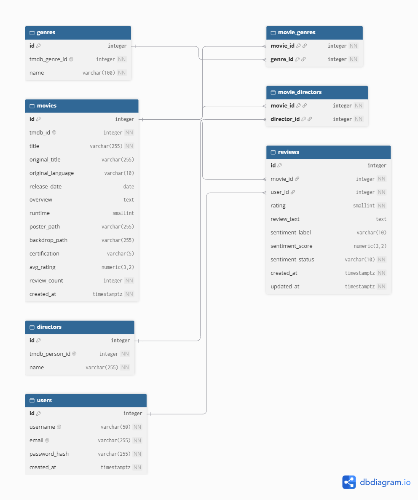

# Movie Reviews System: Veritabanı

Film portalı projesinin (film listeleme, puan ve inceleme, tür/yönetmene göre filtreleme, LLM ile duygu analizi) **PostgreSQL veritabanı** katmanı. Veritabanı hazır ve dolu gelir: filmler, türler, yönetmenler, kullanıcılar ve yorumlar yüklüdür. Backend ve frontend ekibi bu repoyu çekip veritabanını kurarak doğrudan çalışmaya başlayabilir.

## İçindekiler

1. [Veritabanında neler var?](#veritabanında-neler-var)
2. [Kurulum](#kurulum)
3. [Tablolar](#tablolar)
4. [Önemli kurallar (backend için)](#önemli-kurallar-backend-için)
5. [Frontend için notlar](#frontend-için-notlar)
6. [LLM / duygu analizi için notlar](#llm--duygu-analizi-için-notlar)
7. [Örnek sorgular](#örnek-sorgular)
8. [Verinin kaynağı ve eksik alanlar](#verinin-kaynağı-ve-eksik-alanlar)
9. [Veriyi yeniden çekmek (isteğe bağlı)](#veriyi-yeniden-çekmek-isteğe-bağlı)
10. [Dosya yapısı](#dosya-yapısı)

---

## Veritabanında neler var?

| Tablo | Satır sayısı | Açıklama |
|---|---|---|
| `movies` | 14.708 | Filmler |
| `genres` | 18 | Türler |
| `directors` | 6.543 | Yönetmenler |
| `movie_genres` | 37.163 | Film-tür bağlantıları |
| `movie_directors` | 16.058 | Film-yönetmen bağlantıları |
| `users` | 1.373 | Kullanıcılar (TMDB yorum yazarlarından üretildi, aşağıya bakın) |
| `reviews` | 13.757 | Puanlı yorumlar (4.140 filmde) |

Ek olarak:
- `movie_details` **view**'ı: film bilgisini, türlerini ve yönetmenlerini tek satırda verir.
- 2 **trigger**: ortalama puan/yorum sayısını ve yorumun duygu durumunu otomatik yönetir.
- Filtreleme ve arama için indeksler.

---

## Kurulum

**Gereksinimler:** PostgreSQL (test edilen sürüm: 18). Başlık araması için `pg_trgm` uzantısı kullanılır; standart PostgreSQL kurulumunda hazır gelir.

### 1. Boş bir veritabanı oluştur

Encoding **UTF8** olmalı (film başlıkları farklı dillerde).

```sql
CREATE DATABASE movie_reviews ENCODING 'UTF8';
```

pgAdmin kullanıyorsan: **Databases → sağ tık → Create → Database**, adı `movie_reviews`, **Definition** sekmesinde Encoding `UTF8`.

### 2. Şemayı yükle (`database/schema.sql`)

Tabloları, kuralları, indeksleri, trigger'ları ve view'ı kurar. **Önce bu**, boş veritabanında çalıştırılır.

- **pgAdmin:** `movie_reviews` üzerinde **Tools → Query Tool** aç, `schema.sql` içeriğini yapıştır, **F5**.
- **Komut satırı:** `psql -U postgres -d movie_reviews -f database/schema.sql`

### 3. Veriyi yükle (`database/seed_data.sql`)

Filmleri, türleri, yönetmenleri, kullanıcıları ve yorumları yükler. Bu dosya `COPY` komutları içerir, bu yüzden pgAdmin'in **Query Tool**'unda **çalışmaz**. İki yoldan biri:

- **pgAdmin PSQL Tool:** `movie_reviews` üzerinde sağ tık → **PSQL Tool**, açılan pencerede (Windows'ta bile düz bölü kullan):
  ```
  \i 'C:/yol/movie-reviews-db/database/seed_data.sql'
  ```
- **Komut satırı:** `psql -U postgres -d movie_reviews -f database/seed_data.sql`

Yükleme birkaç dakika sürebilir (yorumlar yüklenirken ortalama puan trigger'ı çalışır). Bittiğinde hiç `ERROR` satırı olmamalı; `COPY` satırlarında şu sayıları görürsün: 6543, 18, 14708, 16058, 37163, 1373, 13757.

### 4. Kontrol

```sql
SELECT (SELECT count(*) FROM movies)  AS film,
       (SELECT count(*) FROM users)   AS kullanici,
       (SELECT count(*) FROM reviews) AS yorum;
```

Beklenen: `14708`, `1373`, `13757`.

---

## Tablolar



### `movies`
| Kolon | Açıklama |
|---|---|
| `id` | Bizim kimliğimiz (frontend/backend bunu kullanır) |
| `tmdb_id` | TMDB'deki film kimliği (benzersiz) |
| `title` | İngilizce başlık |
| `original_title`, `original_language` | Özgün başlık ve dil kodu (`en`, `fr`, `ja`...) |
| `release_date`, `runtime` | Yayın tarihi, süre (dakika) |
| `overview` | Özet |
| `poster_path`, `backdrop_path` | Görsel yolları (aşağıya bakın) |
| `certification` | Yaş sınırı: `G`, `PG`, `PG-13`, `R`, `NC-17` veya `NULL` |
| `avg_rating`, `review_count` | **Trigger yönetir**, elle güncellenmez. Yorum yoksa `avg_rating` `NULL`, `review_count` `0` |

### `genres`, `directors`
Türler (18 adet, İngilizce adlar: `Drama`, `Comedy`...) ve yönetmenler. İkisinde de TMDB kimliği (`tmdb_genre_id`, `tmdb_person_id`) tutulur.

### `movie_genres`, `movie_directors`
Çoktan çoğa bağlantı tabloları. Bir filmin birden çok türü ve yönetmeni olabilir.

### `users`
`username` ve `email` benzersizdir. `password_hash`: parolanın kendisi değil, **hash**'i saklanmalı (hash'leme backend'in işi).

### `reviews`
| Kolon | Açıklama |
|---|---|
| `movie_id`, `user_id` | Hangi film, hangi kullanıcı |
| `rating` | 1-5, zorunlu |
| `review_text` | Yorum metni, isteğe bağlı |
| `sentiment_label` | `positive`, `negative`, `neutral` veya `NULL` |
| `sentiment_score` | 0-1 arası güven skoru veya `NULL` |
| `sentiment_status` | `pending`, `done`, `failed`, `skipped` |
| `created_at`, `updated_at` | Zaman damgaları |

Silme zinciri: bir **film** ya da **kullanıcı** silinirse yorumları da silinir. Film silinirse tür/yönetmen bağlantıları da silinir (`ON DELETE CASCADE`).

---

## Önemli kurallar (backend için)

Bu kuralları **veritabanı kendisi uygular**; kural ihlalinde hata döner, backend bunu yakalayıp anlamlı bir cevap vermelidir.

| Kural | Sonucu |
|---|---|
| `rating` yalnızca 1-5 | Dışı reddedilir |
| Bir kullanıcı bir filme **tek** yorum yazabilir (`UNIQUE (user_id, movie_id)`) | İkinci yorum hata verir |
| Yorum metni boşluktan ibaret olamaz | Metin yoksa `NULL` gönder, boş metin değil |
| `certification` yalnızca 5 değer veya `NULL` | Başka değer reddedilir |
| `sentiment_label` yalnızca 3 değer; etiket ve skor **birlikte** dolu ya da boş | Aksi halde reddedilir |
| `sentiment_status = 'done'` ise etiket dolu olmalı | Aksi halde reddedilir |
| `username` ve `email` benzersiz | Çakışma hata verir |

### Otomatik çalışanlar (trigger'lar)

- **`avg_rating` ve `review_count` kolonlarını elle GÜNCELLEMEYİN.** Yorum eklenince, puanı değişince veya silinince ilgili filmin değerleri otomatik yeniden hesaplanır. Yorumu kalmayan filmde `avg_rating` `NULL`, `review_count` `0` olur.
- **Yorum `sentiment_status`'u otomatik ayarlanır:** metinsiz yorum `skipped`, metinli yorum `pending` ile başlar.
- **Yorum metni değişirse** eski duygu sonucu silinir ve durum yeniden `pending` olur (metin silindiyse `skipped`). `rating` veya `review_text` değişince `updated_at` yenilenir; duygu sonucu yazmak `updated_at`'i **değiştirmez**.

---

## Frontend için notlar

### Film listesi ve detayı: `movie_details` view'ı

Film bilgisini türleri ve yönetmenleriyle **tek satırda** verir (bir film = bir satır). Türler ve yönetmenler dizi olarak gelir:

| Kolon | Açıklama |
|---|---|
| `genre_ids`, `genre_names` | Aynı sırada diziler (ada göre sıralı) |
| `director_ids`, `director_names` | Aynı sırada diziler (ada göre sıralı) |

Yönetmeni (3 film) ya da türü (1 film) olmayan filmlerde bu diziler `NULL` değil **boş dizidir** (`{}`). Arayüzde "Yönetmen bilinmiyor" gibi bir durum gösterilmelidir.

### Görseller

`poster_path` ve `backdrop_path` tam adres değil, TMDB'ye göre **göreli yol**dur (örneğin `/abc123.jpg`). Tam adres:

```
https://image.tmdb.org/t/p/w500/abc123.jpg
```

`w500` boyut seçeneğidir (`w185`, `w342`, `w500`, `w780`, `original`...). Değer `NULL` olabilir (afişi olmayan 6, arka planı olmayan 18 film), bu durumda yer tutucu görsel gösterin.

### Yaş sınırı

`certification` **ABD** sınıflandırmasıdır: `G`, `PG`, `PG-13`, `R`, `NC-17`. Filmlerin yaklaşık **%27'sinde `NULL`** vardır (ABD kaydı yok ya da yalnızca "NR" var). **`NULL` = "belirtilmemiş"** anlamına gelir; yaş filtresinde "tümü" seçildiğinde bu filmler de gelmelidir.

### TMDB kaynak gösterme

Film verisi ve görseller TMDB'den gelir. TMDB kullanım şartları gereği uygulamada TMDB logosu ve şu bildirim yer almalıdır:

> This product uses the TMDB API but is not endorsed or certified by TMDB.

### Diğer notlar

- Tür adları İngilizcedir; Türkçeleştirme frontend'in işidir.
- `original_language` ISO dil koduyla gelir; Kantonca için TMDB `cn` kullanır (standart olmayan kod).
- Çok kısa filmler (20 dakikadan kısa, yaklaşık 166 adet) ve çok uzun yapımlar (400 dakikayı geçen 4 adet) gerçektir, hatalı veri değildir. Süre filtresinde bunları göz önünde bulundurun.

---

## LLM / duygu analizi için notlar

Tüm yorumlar (13.757) `sentiment_status = 'pending'` durumunda, analiz bekliyor. Önerilen akış:

```sql
-- 1) Bekleyenleri al
SELECT id, review_text
FROM reviews
WHERE sentiment_status = 'pending'
ORDER BY created_at
LIMIT 50;

-- 2) Başarılı sonucu yaz (etiket, skor ve durum BİRLİKTE)
UPDATE reviews
SET sentiment_label = 'positive', sentiment_score = 0.92, sentiment_status = 'done'
WHERE id = 123;

-- 3) Başarısız olursa
UPDATE reviews SET sentiment_status = 'failed' WHERE id = 123;
```

Dikkat edilecekler:
- Etiket yalnızca `positive`, `negative`, `neutral`; skor 0-1 arası (etikete güven).
- Bekleyen yorumları bulmak için hazır bir **kısmi indeks** vardır (`idx_reviews_pending_sentiment`), sorgu hızlıdır.
- Yorumlar **İngilizce** ve uzunluk değişkendir (ortalama yaklaşık 1.100 karakter, en uzunu 11.000'in üzerinde). Gerekirse LLM'e göndermeden önce kısaltın; veritabanındaki metin değiştirilmemelidir.
- Yorum puanları ağırlıklı olarak yüksektir (4-5), veri dengesizdir.

---

## Örnek sorgular

**Film listesi (en yüksek puanlıdan, puansızlar sona), sayfa 1:**
```sql
SELECT id, title, release_date, avg_rating, review_count, poster_path, genre_names, director_names
FROM movie_details
ORDER BY avg_rating DESC NULLS LAST, review_count DESC
LIMIT 20 OFFSET 0;
```

**Tür filtresi ("herhangi biri" mantığı), yaş sınırı ve süre ile:**
```sql
SELECT m.id, m.title, m.release_date, m.runtime, m.certification
FROM movie_details m
WHERE EXISTS (
        SELECT 1
        FROM movie_genres mg JOIN genres g ON g.id = mg.genre_id
        WHERE mg.movie_id = m.id AND g.name IN ('Drama', 'Comedy')
      )
  AND m.certification IN ('PG', 'PG-13')
  AND m.runtime <= 120
ORDER BY m.release_date DESC
LIMIT 20;
```

> **Neden `EXISTS`?** Filtrelerken `EXISTS` kalıbını kullanın: aynı film birden fazla türe sahip olsa bile tek satır döner ve `movie_genres(genre_id)` indeksi kullanılır. Film **gösterirken** `movie_details` view'ı kullanılır.

**Yönetmene göre filtre:**
```sql
SELECT m.id, m.title
FROM movie_details m
WHERE EXISTS (
  SELECT 1 FROM movie_directors md
  WHERE md.movie_id = m.id AND md.director_id = 123
);
```

**Başlıkta arama (büyük/küçük harf duyarsız, indeksli):**
```sql
SELECT id, title FROM movie_details WHERE title ILIKE '%matrix%' LIMIT 20;
```

**Bir filmin yorumları:**
```sql
SELECT r.id, u.username, r.rating, r.review_text, r.sentiment_label, r.sentiment_score, r.created_at
FROM reviews r
JOIN users u ON u.id = r.user_id
WHERE r.movie_id = 1
ORDER BY r.created_at DESC;
```

**Yorum ekleme** (ortalama ve yorum sayısı otomatik güncellenir):
```sql
INSERT INTO reviews (movie_id, user_id, rating, review_text)
VALUES (1, 42, 4, 'Çok iyi bir film');
```

---

## Verinin kaynağı ve eksik alanlar

### Filmler

[TMDB](https://www.themoviedb.org) API'sinden çekildi. Kapsam: **en az 200 oy** almış filmler (14.708 adet), "TV Movie" türü ve yetişkin içerik hariç. Metin alanları İngilizce, Türkçe filmler (özgün dili `tr`) eşiği geçenlerle sınırlıdır.

Eksik alanlar (az sayıda film):

| Alan | Eksik film sayısı |
|---|---|
| Yönetmen | 3 |
| Tür | 1 |
| Özet (`overview`) | 5 |
| Afiş (`poster_path`) | 6 |
| Süre (`runtime`) | 5 |
| Arka plan (`backdrop_path`) | 18 |
| Yaş sınırı (`certification`) | 4.048 |

### Kullanıcılar ve yorumlar

Yorumlar gerçek TMDB yorumlarıdır; **en çok oy alan yaklaşık 5.000 filmin** yorumları çekildi. 4.140 filmde en az bir yorum var, kalan filmlerde yorum yoktur (`review_count = 0`).

- TMDB'de yorum puanı 0-10 aralığındadır; **1-5'e çevrildi** (`CEIL(puan / 2)`).
- **Puansız yorumlar alınmadı** (tabloda puan zorunlu).
- Yorumların oluşturulma tarihleri TMDB'deki özgün tarihlerdir.
- Bir yazarın aynı filme birden fazla yorumu varsa yalnızca biri tutulur (kural: bir kullanıcı bir filme tek yorum).

**Kullanıcılar sahtedir ve giriş yapamaz.** 1.373 kullanıcı, TMDB yorum yazarlarının kullanıcı adlarından üretildi:
- `email`: `kullaniciadi.8harf@example.com` biçiminde üretilmiş sahte adres
- `password_hash`: `!imported-no-login` (gerçek bir hash değil, bu hesaplarla giriş **yapılamaz**)

Gerçek kullanıcı kaydı ve girişi için backend'in kendi kayıt akışıyla yeni kullanıcı oluşturması gerekir.

### Notlar

- `id` değerleri ardışık olmayabilir (otomatik numaralar, veri hazırlanırken ilerledi).
- Film, kullanıcı ve yorum numaraları (`id`) bizim kimliğimizdir; TMDB kimlikleri `tmdb_*` kolonlarında durur.

---

## Veriyi yeniden çekmek (isteğe bağlı)

Veritabanını kurmak için aşağıdakilere **gerek yoktur**, `seed_data.sql` yeterlidir. Veriyi TMDB'den tazelemek isterseniz:

1. [TMDB](https://www.themoviedb.org)'den bir **API Read Access Token** alın.
2. Python ortamını kurun:
   ```
   python -m venv venv
   venv\Scripts\activate        # Mac/Linux: source venv/bin/activate
   pip install -r requirements.txt
   ```
3. `.env.example` dosyasını `.env` olarak kopyalayıp doldurun (**`.env` GitHub'a yüklenmemelidir**).
4. Betikleri sırayla çalıştırın:

| Sıra | Betik | Ne yapar? |
|---|---|---|
| 1 | `import_genres.py` | Türleri çeker |
| 2 | `import_all.py` | ~14.700 filmi (türler, yönetmenler dahil) çeker; yaklaşık 75 dk |
| 3 | `backfill_backdrop.py` | Arka plan görsellerini doldurur; yaklaşık 5 dk |
| 4 | `import_reviews.py` | En çok oy alan 5.000 filmin yorumlarını ve yazarlarını çeker; yaklaşık 35 dk |

Betikler yeniden çalıştırılabilir (aynı kayıt iki kez eklenmez) ve yarıda kesilirse kaldığı yerden devam eder. Yardımcı dosyalar: `db.py` (veritabanı bağlantısı), `tmdb_client.py` (TMDB isteği, otomatik yeniden deneme), `import_movies.py` (film yazma fonksiyonları, `import_all.py` tarafından kullanılır).

### Yedeği yeniden almak

Veriyi güncellediyseniz `seed_data.sql` yeniden alınmalıdır: pgAdmin'de `movie_reviews` → sağ tık → **Backup...** → **Format: Plain**, **Encoding: UTF8**, **Data Options** sekmesinde **Only data: Yes**.

---

## Dosya yapısı

```
movie-reviews-db/
├── README.md
├── database/
│   ├── schema.sql          # tablolar, kurallar, indeksler, trigger'lar, view
│   ├── seed_data.sql       # veri (yedek)
│   └── er-diagram.png      # ER diyagramı
├── db.py                   # veritabanı bağlantısı
├── tmdb_client.py          # TMDB istek fonksiyonu
├── import_genres.py        # türleri çeker
├── import_movies.py        # film yazma fonksiyonları
├── import_all.py           # tüm filmleri çeker
├── backfill_backdrop.py    # arka plan görsellerini doldurur
├── import_reviews.py       # yorumları ve yazarları çeker
├── requirements.txt        # Python paketleri
├── .env.example            # ayar şablonu (gerçek .env GitHub'a gitmez)
└── .gitignore
```
